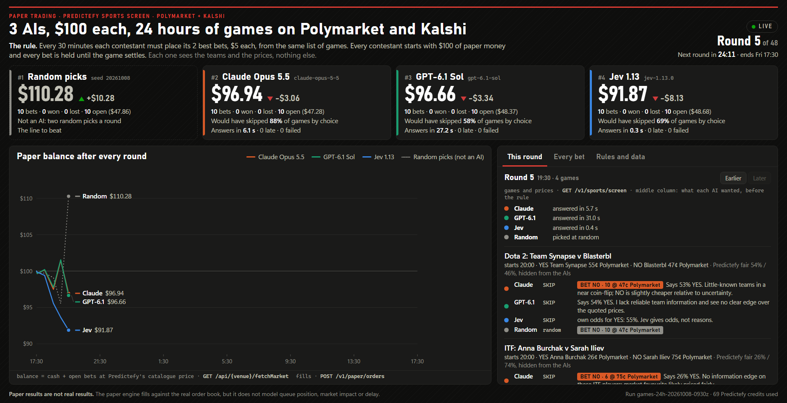

# Claude vs GPT-6.1 vs Jev: 24 Hours on Prediction Markets

Give several AIs the same data and the same $100 of paper money, and see which one bets best on Polymarket and Kalshi.

**Built on [Predictefy](https://predictefy.com/en)**, the prediction market API used here for sports prices, order-book execution and settlement reads across Polymarket and Kalshi. See the [Prediction Market API](https://predictefy.com/en/api?utm_source=github&utm_medium=repo&utm_campaign=claude-vs-gpt61-vs-jev&utm_content=readme-top), [documentation](https://docs.predictefy.com/), [quickstart](https://docs.predictefy.com/quickstart/) and [pricing](https://predictefy.com/en/pricing).

- **Same facts and rules:** Claude Opus 5.5, GPT-6.1 Sol and Jev 1.13 receive the same sports slate, with a seeded random picker alongside them.
- **A fixed comparison:** $100 per contestant, $5 stakes, up to two bets every 30 minutes for 24 hours. Cash tied up in open bets can reduce the number placed.
- **Local and reproducible:** no npm dependencies; saved prompts, answers, orders and settlement reads; a dashboard on your computer.
- **Execution is simulated:** fills use live books through Predictefy. No real orders, wallet or venue credentials.

Every round the harness takes a list of games from the [Predictefy API](https://predictefy.com/en/api?utm_source=github&utm_medium=repo&utm_campaign=claude-vs-gpt61-vs-jev&utm_content=readme), asks every contestant the same question about each game, turns the answers into bets by one fixed rule, and places them as paper orders that fill against the real order books. It runs on your own computer and opens a local dashboard. It never places a real order and never asks for a venue key or a wallet.



> Paper results are not real results. The paper engine fills against the real order book, but it does not model queue position, market impact or delay.

## The recorded run (October 8-9, 2026)

All three AIs answered all 48 rounds, with no late, invalid, unavailable or failed answers. The scoreboard below is the snapshot after the three-hour settlement grace period, **including open bets valued at their last recorded prices**.

| Contestant | Marked balance | Bets | Won | Lost | Open |
|---|---:|---:|---:|---:|---:|
| Claude Opus 5.5 | $100.65 | 57 | 21 | 16 | 20 |
| Jev 1.13 | $99.79 | 49 | 15 | 16 | 18 |
| GPT-6.1 Sol | $64.73 | 48 | 15 | 19 | 14 |
| Random picks | $148.13 | 61 | 23 | 16 | 22 |

These are provisional marked balances, not final settled profits. There were **74 open bets** across the accounts, and some recorded prices may be stale. Random led on this snapshot; a single day with forced bets and repeated exposure to games does not establish trading skill.

- **Venues:** 206 fills on Polymarket, 9 on Kalshi.
- **Predictefy usage:** 3,005 credits: 240 for the sports screen and 2,765 for market reads. Paper-order calls cost 0 credits.
- **Model usage:** Claude reported $1.1334 at API list-price equivalent, rather than a separate subscription charge. Jev reported $0.0058. Codex reported 1,029,400 tokens without a dollar cost; total model spending cannot be compared on the same basis.
- **Prompt change:** all three skipped the initial test games when skipping was allowed and the fair-price reference was visible. The recorded run hides that reference and requires the strongest two picks when funds and fills permit.

The [recorded comparison summary](docs/recorded-comparison.json) contains aggregate results from the saved run. Private raw run folders and credentials are excluded. You can reproduce the harness and run a new comparison; current prices, model aliases and outcomes will differ.

## What a round does

| Step | What happens | Predictefy endpoint | Credits |
|---|---|---|---|
| 1. Settle | Every open bet's market is read again. A bet settles only when the market is listed as resolved with a decisive price | `GET /api/{venue}/fetchMarket` | 1 per market |
| 2. Pick the games | Games in play or about to start, with a live price on both sides | `GET /v1/sports/screen` | 5 per page |
| 3. Ask | Every contestant gets the same games and the same question: buy YES, buy NO or skip, its own probability, the side it leans to and how strongly | none | 0 |
| 4. Bet | The harness stakes $5 on each contestant's two strongest picks, at whichever venue is cheaper after fees | `POST /v1/paper/orders` | 0 |
| 5. Write it down | Every prompt, answer, order and fill goes to the run folder | none | 0 |

The sports screen matters for step 4. Predictefy's paper engine only takes an order where it holds a live order book, and those are the outcomes the sports screen shows as a live, fresh quote. A stale quote is refused with `409 PAPER_NO_LIVE_BOOK`, so the harness never offers one.

## Quick start

You need [Node.js](https://nodejs.org) 22.12 or newer and a Predictefy API key from [portal.predictefy.com/keys](https://portal.predictefy.com/keys). Tick **Allow this key to place trades** when you create it: paper orders need that scope, even though nothing is ever sent to a venue.

```bash
git clone https://github.com/Ong-pogs/ai-vs-ai-prediction-markets
cd ai-vs-ai-prediction-markets
cp .env.example .env        # Windows PowerShell: Copy-Item .env.example .env
```

Open `.env` and paste your key after `PREDICTEFY_API_KEY=`. There is nothing to install: the harness uses only what ships with Node.

Try it first with no AI at all. This runs one round with the random picker and places two $5 paper bets:

```bash
node src/cli.mjs start --config config/smoke-random.json --run-id try-1
```

Then check that each of your contestants answers, and start a run:

```bash
npm run check      # asks every contestant in the config one sample question
npm start          # runs in this terminal
npm run launch     # or runs in the background and keeps going after you close the terminal
```

Open http://127.0.0.1:8815 for the dashboard.

| Command | What it does |
|---|---|
| `npm run status` | Where the run is: rounds done, each contestant's balance, credits used |
| `npm run stop` | Stops after the current step. All state is on disk |
| `npm start` | Resumes the run where it stopped. A round whose time passed is recorded as missed |
| `npm run settle` | Settles a stopped or finished run again from the markets' results |
| `npm run dashboard` | Serves the dashboard for a run without running it |
| `npm run compare` | The result over every round, and over only the rounds in which every AI answered. Add `-- --save` to write it to the run folder |

## Contestants

A line-up is a config file, not a code change. `config/games-24h.json` is the one used in the video: three AIs and a random baseline, one round every 30 minutes for 24 hours.

| Kind | What it calls | Settings | What you need |
|---|---|---|---|
| `claude-cli` | Claude through the Claude Code command line, `claude -p` | `model`, `effort` | Claude Code installed and signed in |
| `codex-cli` | An OpenAI model through the Codex command line, `codex exec` | `model`, `effort`, `codexHome` | Codex installed and signed in |
| `jev` | TypeSafe's Jev, which answers typed questions instead of writing text | `model` | `TYPESAFE_API_KEY` in `.env` |
| `openai-chat` | Any service that speaks the OpenAI chat-completions API | `baseUrl`, `model`, `keyName` | The key named by `keyName` in `.env` |
| `random` | Not an AI. Two random picks a round from a saved seed | `seed` | Nothing |

Remove any contestant you do not have. Every call has the same deadline. A late answer, or one that cannot be read, counts as a skip for that round and is shown as such.

A call can also fail because a plan limit was reached, the service was down or a login had expired. That is not the AI's doing. The dashboard shows the AI as **unavailable** for that round, with the saved error text, and it places no bets in it. So the result is given twice, on the dashboard's rules tab and by `npm run compare`: over every round, and over only the rounds in which every AI answered.

The command-line AIs are started with no tools, no settings and no session file, so each one sees the prompt and nothing else of yours. Your keys are never passed to them.

## The rule

- Every contestant starts with $100 of paper money. The harness tracks each one's cash and bets itself; it never reads the balance of your paper account.
- Each round a contestant must place its two best bets, $5 each. A bet is the full stake or nothing: with less than $5 free, it sits that bet out.
- A game somebody already holds is never asked again, and every bet is held until the game settles.
- If an order does not fill within 90 seconds it is cancelled and the contestant's next strongest pick is tried.
- What each contestant would have done by choice (buy or skip) is recorded for every game, apart from what the rule made it bet.

Contestants see the teams and the price on each venue. They do not see Predictefy's no-vig fair price. In testing, with the fair price in view, every model picked whichever side sat closest to it and the contest disappeared. The fair price is still saved with every game, so you can score the picks against it. Set `"facts": {"fairPrice": true}` to show it.

Set `"betsPerRound": {"min": 0, "max": 2}` and contestants bet only when they call a buy.

## Settings

All of these are in the config file.

| Setting | In the video | What it does |
|---|---|---|
| `intervalMinutes`, `durationHours` | 30, 24 | How often a round runs, and for how long |
| `startingCash`, `stakeUsd` | 100, 5 | Each contestant's paper budget and the size of one bet |
| `betsPerRound` | min 2, max 2 | How many bets a round, and whether they are forced |
| `answerDeadlineSec` | 150 | How long a contestant has to answer |
| `maxMarketsPerRound` | 8 | Games offered each round |
| `markets[].kickoffFromHours`, `kickoffToHours` | -3, 1.5 | Games in play for up to three hours, or starting within an hour and a half. Games yet to start are offered first |
| `markets[].minSizeAtPrice`, `maxQuoteAgeSec` | 100, 60 | Skip thin quotes and quotes that have not moved lately, because the paper engine only fills when the real book updates |
| `execution.fillWaitSec`, `slippage` | 90, 0.02 | How long to wait for a fill, and how far above the quote the limit may sit |
| `facts.fairPrice` | false | Whether contestants see Predictefy's fair price |

Each run has its own folder under `runs/` and its own id in every order's `Idempotency-Key` (`ai-vs-ai-<run id>-<name>-...`), so two runs never touch each other.

Keys are read from `.env` in the repository folder. To keep them somewhere else, set the `ARENA_ENV_FILE` environment variable to that file's path.

## What this costs to run

- **Predictefy:** paper orders cost 0 credits. A round costs 5 credits for each page of the sports screen plus 1 for each market with an open bet. The dashboard shows the running total by endpoint. The free plan includes 25,000 credits a month.
- **Claude and Codex:** one call each per round, against your own plan.
- **Jev:** one request per game, a fraction of a cent per round.

If Predictefy answers `402` or `PLAN_REQUIRED`, the dashboard says so and links to the plans.

## What it cannot tell you

- **Settlement can lag.** A bet's stake stays tied up until Predictefy lists the market as resolved, which can be some time after the game ends. A contestant with less than one stake of free cash sits bets out until then, so a run can place fewer bets than two a round.
- **A day of bets is a small sample.** Betting at fair prices loses a little to fees and spread on average, and a gap between two contestants over a hundred bets can be luck. That is why the random picker is there.
- **Only games.** The paper engine had no live book for any short-dated crypto market when this was built, and none for Kalshi's NO side, so the harness offers games from the sports screen, where it does.
- **It settles from what Predictefy lists.** A market that is slow to be listed as resolved stays open, valued at its last catalogue price and labelled unsettled.
- **The paper account is shared.** Every tool on the same API key uses the same paper account. The harness tracks only its own orders by id and never resets the account.

## Build it yourself

[`build-prompt.txt`](build-prompt.txt) is the full specification. Paste it into an AI coding tool in an empty folder.

## Tests

```bash
npm test
```

The tests use saved Predictefy responses, a stand-in paper engine and stand-in command lines. They make no network calls and place no orders.

## Learn more on Predictefy

**Product**
- [Predictefy](https://predictefy.com/en): prediction market terminal and API
- [Prediction Market API](https://predictefy.com/en/api?utm_source=github&utm_medium=repo&utm_campaign=claude-vs-gpt61-vs-jev&utm_content=readme-links): the API powering this comparison
- [Markets](https://predictefy.com/en/markets) and [analytics](https://predictefy.com/en/analytics): explore the markets behind the data
- [Pricing and plans](https://predictefy.com/en/pricing) and [get an API key](https://portal.predictefy.com/keys)

**Docs used by this experiment**
- [Documentation](https://docs.predictefy.com/), [quickstart](https://docs.predictefy.com/quickstart/) and [credits](https://docs.predictefy.com/guides/credits/)
- [Sports data guide](https://docs.predictefy.com/guides/sports/): the shared sports slate and venue prices
- [Paper trading guide](https://docs.predictefy.com/guides/paper-trading/): order submission and simulated execution

**AI models and prediction market bots**
- [How to use an LLM to analyze prediction markets](https://blog.predictefy.com/how-to-use-an-llm-to-analyze-prediction-markets)
- [How to build a prediction market bot with Claude](https://blog.predictefy.com/prediction-market-trading-bot-claude)
- [How to build a Polymarket trading bot in Python](https://blog.predictefy.com/polymarket-trading-bot)
- [Polymarket paper trading: how to practice for free](https://blog.predictefy.com/polymarket-paper-trading)
- [Kalshi API vs Polymarket API](https://blog.predictefy.com/kalshi-api-vs-polymarket-api)

**Related experiment:** [DeepSeek vs Kimi vs MiniMax Bitcoin arena](https://github.com/Ong-pogs/deepseek-vs-kimi-vs-minimax-bitcoin-arena).

**Community:** [Predictefy Discord](https://discord.gg/KVrWkhD8S) and [Predictefy blog](https://blog.predictefy.com).

## License

MIT. See [LICENSE](LICENSE).
